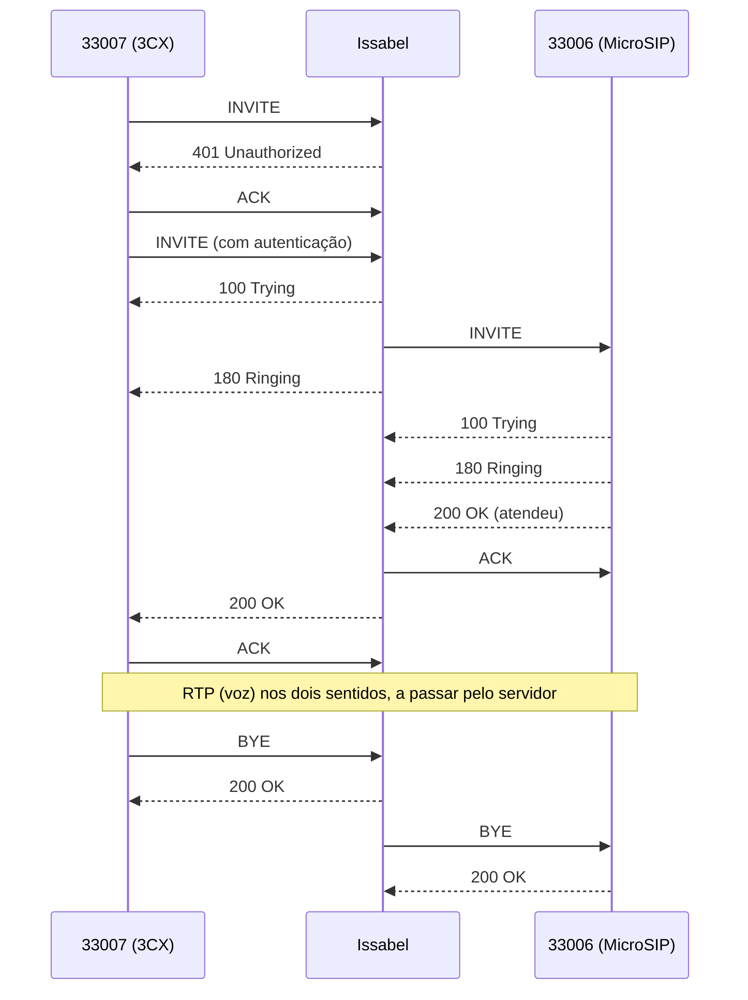
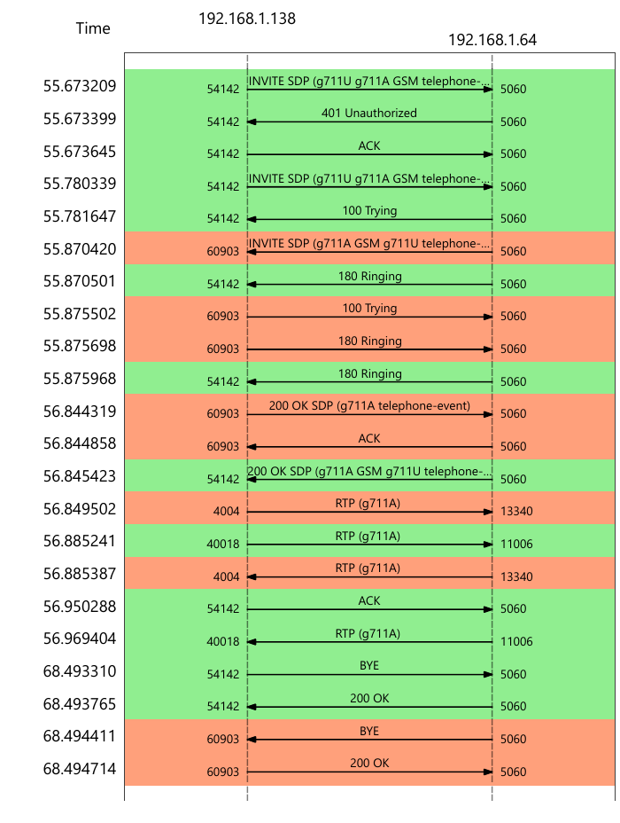

# Fase 3: captura e análise da chamada

> **Estado:** captura feita por mim a 1 de novembro de 2026, no servidor
> Issabel. Análise feita a partir do ficheiro da captura.
> O ficheiro `.pcap` **não é publicado**: contém o áudio da chamada e os
> hashes de autenticação das extensões (ver secção 6).

## 1. Como foi feita a captura

Na VM do Issabel:

```
tcpdump -i eth0 -n -w /root/chamada.pcap 'udp port 5060 or udp portrange 10000-20000'
```

O filtro apanha só o SIP (porta 5060) e a gama de portas RTP do Asterisk
(10000 a 20000). Capturar no servidor tem a vantagem de ver as duas
"pernas" da chamada, porque todo o tráfego passa por ele.

Depois copiei o ficheiro para o Windows com `scp` e abri-o no Wireshark.

| Dado | Valor |
|---|---|
| Pacotes capturados | 2423 |
| Duração da captura | 78,7 segundos |

## 2. Quem é quem

| Extensão | Softphone (campo User-Agent) | Endereço |
|---|---|---|
| 33006 | MicroSIP 3.22.20 | 192.168.1.138, porta 60903 |
| 33007 | 3CXPhone 6.0 | 192.168.1.138, porta 54142 |
| Servidor | Asterisk 16.7.0 (Issabel) | 192.168.1.64, porta 5060 |

A chamada foi feita da **33007 (3CX) para a 33006 (MicroSIP)**.

## 3. Fluxo da chamada



Tempos (segundos desde o início da captura):

| Momento | Tempo |
|---|---|
| Primeiro INVITE da 33007 | 55,67 |
| 180 Ringing (a 33006 começa a tocar) | 55,87 |
| 200 OK (a 33006 atende) | 56,84 |
| BYE (a 33007 desliga) | 68,49 |

A chamada esteve atendida cerca de 11,6 segundos.

**Observação:** o servidor respondeu ao primeiro INVITE com
`401 Unauthorized`. Não é um erro. O Asterisk pede autenticação não só no
registo mas também em cada chamada, e o 3CX repetiu o INVITE já com as
credenciais.

**Observação:** são duas chamadas SIP diferentes, cada uma com o seu
`Call-ID`: uma entre a 33007 e o servidor, outra entre o servidor e a 33006.
O Asterisk está no meio e liga as duas.

### Vista no Wireshark

Abri a captura no Wireshark em Telephony, VoIP Calls, Flow Sequence, com as
duas pernas selecionadas, e exportei o fluxo completo (do primeiro INVITE
ao último 200 OK do BYE):



(Cortei a coluna de comentários porque mostrava o nome de utilizador
configurado no softphone.)

- As cores separam as duas pernas: a verde é a ligação entre o 3CX e o
  servidor, a laranja é a ligação entre o servidor e o MicroSIP.
- Como os dois softphones estão no mesmo computador, o Wireshark só mostra
  uma coluna para 192.168.1.138. A perna distingue-se pela porta: 54142 (3CX)
  ou 60903 (MicroSIP).

**Observação:** o 3CX enviou o INVITE com o nome que estava configurado no
softphone, mas o INVITE que o servidor mandou para a 33006 já levava o nome
"T2". O Asterisk substitui o nome do chamador pelo que está definido na
extensão 33007 no Issabel (provavelmente o campo Display Name).

## 4. Negociação do codec (SDP)

| Mensagem | Codecs oferecidos ou escolhidos |
|---|---|
| INVITE da 33007 (3CX) | PCMU, PCMA, GSM e vídeo H.263 |
| INVITE do servidor para a 33006 | PCMA, GSM, PCMU (sem vídeo) |
| 200 OK da 33006 (MicroSIP) | **PCMA** |
| 200 OK do servidor para a 33007 | PCMA; vídeo recusado (porta 0) |

Resultado: os dois lados usaram **G.711 A-law (PCMA)**, o codec habitual
na Europa. O 3CX também propôs vídeo, mas o servidor recusou-o: na
resposta, a linha de vídeo vem com a porta 0.

## 5. Tráfego de voz (RTP)

| Origem | Destino | Pacotes | Perdidos | Jitter médio |
|---|---|---|---|---|
| 33007 (3CX) :40018 | Servidor :11006 | 579 | 0 | 0,67 ms |
| Servidor :11006 | 33007 (3CX) :40018 | 577 | 0 | 0,11 ms |
| 33006 (MicroSIP) :4004 | Servidor :13340 | 583 | 0 | 0,10 ms |
| Servidor :13340 | 33006 (MicroSIP) :4004 | 579 | 0 | 0,67 ms |

O que isto mostra:

- Há voz nos **dois sentidos** e nas duas pernas da chamada.
- Os pacotes saem de 20 em 20 ms (`ptime:20`), cerca de 50 por segundo,
  o normal para G.711.
- Nenhum pacote perdido e jitter abaixo de 2 ms. Era de esperar, porque
  está tudo na mesma rede local.
- O RTP passa pelo servidor em vez de ir diretamente de um softphone para
  o outro. As portas do servidor (11006 e 13340) estão dentro da gama
  10000 a 20000.

## 6. O que a captura mostra sobre segurança

- **Nada vai cifrado.** Na captura vê-se quem ligou a quem, quando e com que
  softphone. O áudio também pode ser reconstruído no Wireshark
  (Telephony, VoIP Calls, Play Streams).
- **A password não aparece, mas o hash aparece.** No INVITE autenticado, o
  campo `Authorization` leva o utilizador, o `nonce` e uma `response`
  calculada com MD5 a partir da password. Quem tiver esta captura pode
  tentar adivinhar a password offline, testando milhões de hipóteses.
  Com uma password fraca, isso é rápido. Por isso não publico o `.pcap`.
- **O peer `sim` gera tráfego inútil.** Durante a captura, o servidor
  enviou 30 pedidos `OPTIONS` para 172.20.10.10 (6 verificações, cada uma
  com 5 tentativas, uma por segundo) e não recebeu nenhuma resposta. É isto que faz aparecer
  `UNREACHABLE` no `sip show peers`.

Estes pontos ficam para a fase de segurança.
