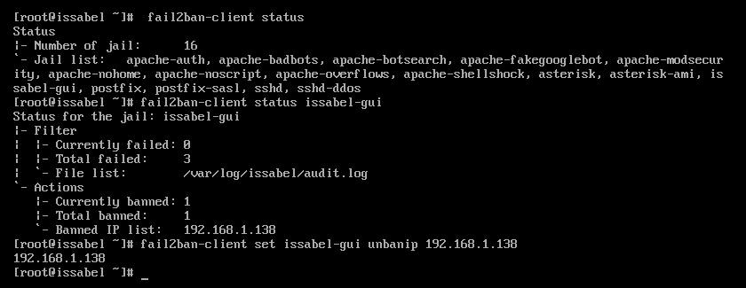

# Fase 4: diagnóstico do bloqueio no acesso HTTPS

> **Estado:** problema real, que aconteceu e resolvi durante as aulas.
> O resumo abaixo é o meu relato. Os comandos exatos e os resultados vão
> ser confirmados reproduzindo o problema de forma controlada no
> laboratório.

## O que aconteceu

Depois de várias tentativas de login com a password errada na interface
web do Issabel, deixei de conseguir aceder à interface a partir do meu
computador.

## Causa

O **fail2ban** do Issabel detetou as tentativas de login falhadas e
bloqueou o IP do meu computador. O fail2ban lê os registos (logs) dos
serviços e, quando um IP falha a autenticação demasiadas vezes num certo
intervalo de tempo, cria uma regra de firewall que bloqueia esse IP
durante algum tempo.

Ou seja: não era uma avaria, era a proteção do servidor a funcionar como
devia. O "atacante" era eu.

## Como resolvi

1. Investiguei a causa do bloqueio com comandos do próprio servidor.
2. Retirei o IP do meu computador da lista de IPs bloqueados.

## Comandos usados (registados a 1 de novembro de 2026)

Na consola da VM, no VirtualBox:



**1. Ver que regras de vigilância (jails) existem:**

```
[root@issabel ~]# fail2ban-client status
Status
|- Number of jail:      16
`- Jail list:   apache-auth, apache-badbots, apache-botsearch, apache-fakegooglebot,
                apache-modsecurity, apache-nohome, apache-noscript, apache-overflows,
                apache-shellshock, asterisk, asterisk-ami, issabel-gui, postfix,
                postfix-sasl, sshd, sshd-ddos
```

O Issabel traz 16 jails ativas. A que interessa aqui é a `issabel-gui`, que
vigia os logins na interface web. Há também jails para o SSH (`sshd`) e para
o SIP (`asterisk`).

**2. Ver o estado da jail da interface web:**

```
[root@issabel ~]# fail2ban-client status issabel-gui
Status for the jail: issabel-gui
|- Filter
|  |- Currently failed: 0
|  |- Total failed:     3
|  `- File list:        /var/log/issabel/audit.log
`- Actions
   |- Currently banned: 1
   |- Total banned:     1
   `- Banned IP list:   192.168.1.138
```

O que isto mostra:

- A jail lê o ficheiro `/var/log/issabel/audit.log`, onde ficam registados
  os logins na interface web.
- Foram contadas 3 tentativas falhadas.
- O IP **192.168.1.138, o do meu computador, estava bloqueado**. Esta era a
  causa de não conseguir abrir a interface.

**3. Desbloquear o IP:**

```
[root@issabel ~]# fail2ban-client set issabel-gui unbanip 192.168.1.138
192.168.1.138
```

O comando devolve o IP desbloqueado, sinal de que funcionou.

## Regras da jail `issabel-gui`

```
[root@issabel ~]# fail2ban-client get issabel-gui maxretry
3
[root@issabel ~]# fail2ban-client get issabel-gui findtime
600
[root@issabel ~]# fail2ban-client get issabel-gui bantime
2400
```

Em linguagem simples: **3 logins falhados em 10 minutos** (600 s) bloqueiam
o IP durante **40 minutos** (2400 s). Bate certo com o que vi: as 3
tentativas falhadas registadas na jail foram suficientes para o bloqueio.

Se não tivesse desbloqueado o IP à mão, teria voltado a ter acesso
sozinho ao fim de 40 minutos.

## Reprodução controlada (1 de novembro de 2026)

Repeti o problema de propósito para registar o que se vê de cada lado.
Fiz logins com a password errada na interface web até ser bloqueada.

**1. Sintoma, visto do Windows (durante o bloqueio):**

```
PS> Test-NetConnection 192.168.1.64 -Port 443
WARNING: TCP connect to (192.168.1.64 : 443) failed

ComputerName           : 192.168.1.64
RemoteAddress          : 192.168.1.64
RemotePort             : 443
InterfaceAlias         : Wi-Fi
SourceAddress          : 192.168.1.138
PingSucceeded          : True
PingReplyDetails (RTT) : 0 ms
TcpTestSucceeded       : False
```

O ping funciona, mas a ligação à porta 443 falha. Ou seja, a rede entre o
meu computador e o servidor está bem; o problema está só no acesso ao
serviço web. É isto que leva a procurar a causa no servidor e não na rede.

**2. A regra de firewall criada pelo fail2ban:**

```
[root@issabel ~]# iptables -S | grep 192.168.1.138
-A f2b-issabel-gui -s 192.168.1.138/32 -j REJECT --reject-with icmp-port-unreachable
```

- O fail2ban tem uma cadeia própria no iptables para esta jail
  (`f2b-issabel-gui`) e acrescentou-lhe uma regra para o meu IP (`/32`, um
  único endereço).
- A ação é `REJECT`: o servidor recusa a ligação e avisa o cliente com uma
  mensagem ICMP "port unreachable". Por isso o teste falha logo, em vez de
  ficar à espera até dar timeout, como aconteceria com `DROP`.
- O ping continuou a funcionar, o que mostra que a regra não bloqueia todo
  o tráfego do meu IP, só o que é encaminhado para esta cadeia (o acesso à
  interface web).

**3. Desbloqueio e verificação:**

Depois de `fail2ban-client set issabel-gui unbanip 192.168.1.138` na VM:

```
PS> Test-NetConnection 192.168.1.64 -Port 443

ComputerName     : 192.168.1.64
RemoteAddress    : 192.168.1.64
RemotePort       : 443
InterfaceAlias   : Wi-Fi
SourceAddress    : 192.168.1.138
TcpTestSucceeded : True
```

O acesso à porta 443 voltou. (Quando a ligação TCP funciona, o
`Test-NetConnection` já não faz o ping, por isso essas linhas não aparecem.)

## Resumo do diagnóstico

| Passo | O que fiz | O que mostrou |
|---|---|---|
| Sintoma | `Test-NetConnection` à porta 443 | Ping OK, porta 443 falha |
| Hipótese | O problema é no servidor, não na rede | |
| Causa | `fail2ban-client status issabel-gui` | O meu IP está na lista de bloqueados |
| Confirmação | `iptables -S` | Regra `REJECT` para o meu IP |
| Solução | `fail2ban-client set issabel-gui unbanip` | IP desbloqueado |
| Verificação | `Test-NetConnection` à porta 443 | Ligação OK |

## O que aprendi

(Por preencher.)
